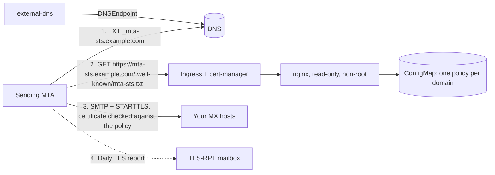

<p align="center">
  <a href="https://dmarc-examiner.com">
    
  </a>
</p>

<h1 align="center">DMARC Examiner Helm Charts</h1>

<p align="center">
  Email security building blocks for Kubernetes, maintained by <a href="https://dmarc-examiner.com">DMARC Examiner</a>.
</p>

<p align="center">
  <a href="https://github.com/dmarc-examiner/helm-charts/actions/workflows/lint-test.yaml"></a>
  <a href="https://github.com/dmarc-examiner/helm-charts/actions/workflows/release.yaml"></a>
  <a href="https://github.com/dmarc-examiner/helm-charts/tree/main/charts/mta-sts"></a>
  <a href="https://artifacthub.io/packages/search?repo=dmarc-examiner"></a>
  
  <a href="LICENSE"></a>
</p>

---

## Charts

| Chart | Description |
|---|---|
| [`mta-sts`](charts/mta-sts) | Serves MTA-STS policies (RFC 8461) for one or many domains. Publishes the `_mta-sts` and TLS-RPT records through external-dns, or prints them for you. |

## Quick start

Install from the OCI registry:

```bash
helm install mta-sts oci://ghcr.io/dmarc-examiner/charts/mta-sts \
  --namespace mta-sts --create-namespace \
  --set 'domains[0].name=example.com' \
  --set 'policy.mx[0]=mx1.example.com' \
  --set 'tlsRpt.rua[0]=mailto:tls-reports@{domain}' \
  --set ingress.certManager.clusterIssuer=letsencrypt
```

Or add the classic Helm repository:

```bash
helm repo add dmarc-examiner https://dmarc-examiner.github.io/helm-charts
helm repo update
helm install mta-sts dmarc-examiner/mta-sts -f values.yaml
```

The install notes print the DNS records to create. See the [chart README](charts/mta-sts) for every option.

## Why MTA-STS

SMTP between mail servers encrypts only when both sides agree to. An attacker in the path can strip the `STARTTLS` offer or point your MX to their own server, and the sender falls back to plain text without telling anyone.

MTA-STS closes that gap. Your domain publishes a policy over HTTPS that says which MX hosts are valid and that TLS is mandatory. Senders that support it, such as Gmail and Microsoft 365, cache the policy and refuse to deliver over an insecure or unverified connection.

TLS-RPT is the feedback loop. Senders mail you a daily JSON report of every TLS failure they saw, so you can move from `testing` to `enforce` with evidence instead of hope.

## How it works



- One release serves every domain you list. Each one gets its own `mta-sts.<domain>` host and policy.
- The policy `id` is the first 20 hex characters of the SHA-256 of the policy file. It changes only when the policy changes, which is exactly when senders need to refetch it.
- With `externalDns.enabled`, the chart creates a `DNSEndpoint` so external-dns keeps the TXT records in sync with the policy.

## Safe rollout

1. Install with `policy.mode: testing` (the default) and a TLS-RPT destination.
2. Read the TLS-RPT reports for one or two weeks. Every failure is a sender that would bounce in `enforce`.
3. Switch to `policy.mode: enforce` and run `helm upgrade`. The policy `id` changes on its own.
4. Before you migrate MX hosts, add the new ones to `policy.mx` first. Senders cache the old list for `maxAge` seconds.

## Verify

```bash
curl -s https://mta-sts.example.com/.well-known/mta-sts.txt
dig +short TXT _mta-sts.example.com
dig +short TXT _smtp._tls.example.com
helm test mta-sts -n mta-sts
```

Or run the free [email compliance checker](https://dmarc-examiner.com/tools/email-compliance), which validates the TXT record, the policy file and its certificate in one go.

## Quality

Every pull request runs:

| Check | Tool |
|---|---|
| Chart lint and YAML lint | [chart-testing](https://github.com/helm/chart-testing) |
| Unit tests on rendered templates | [helm-unittest](https://github.com/helm-unittest/helm-unittest) |
| Manifest validation against Kubernetes and CRD schemas | [kubeconform](https://github.com/yannh/kubeconform) |
| Real install plus `helm test` on two Kubernetes versions | [kind](https://kind.sigs.k8s.io) |

Run the same checks locally:

```bash
ct lint --config ct.yaml --all
helm unittest charts/*
kind create cluster && ct install --config ct.yaml --all
```

## About DMARC Examiner

[DMARC Examiner](https://dmarc-examiner.com) monitors DMARC for your domains. It turns aggregate reports into clear answers: who sends mail as you, what fails and what to fix before you tighten your policy.

Once this chart is running, check the whole setup (MTA-STS, TLS-RPT, SPF, DKIM and DMARC) with the free [email compliance checker](https://dmarc-examiner.com/tools/email-compliance).

## License

[MIT](LICENSE)
